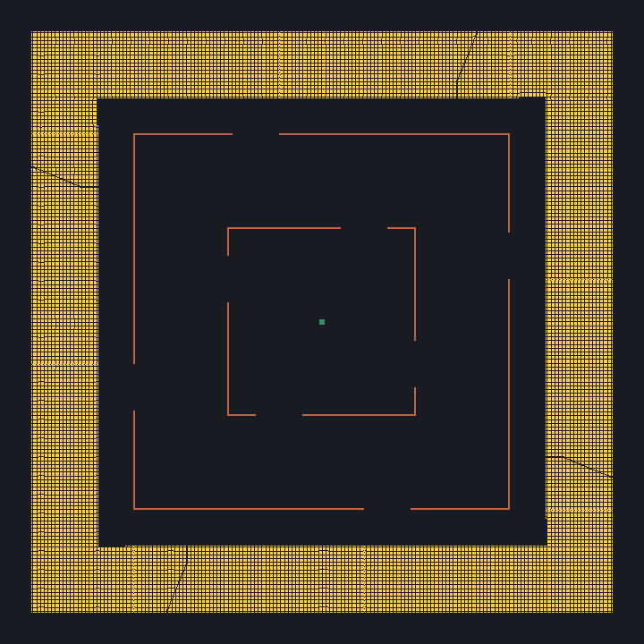

# MassMotion

MassMotion is a C++20 library for simulating large groups of agents moving toward
a shared goal on a 2D grid. It supports obstacles, separation between nearby
agents, and multithreaded updates.

The project includes an SDL3 viewer and a standalone simulation benchmark.



## Performance

Example results from [`SimulationBenchmark.cpp`](benchmarks/SimulationBenchmark.cpp):

- Apple M1 Pro, 8 CPU cores, 16 GB RAM, macOS 27.2.
- Apple Clang 17, Release build (`-O3 -DNDEBUG`), profiling disabled.
- 8 worker threads.

Each scenario runs five times with fresh agents. Each run has 30 warm-up steps
followed by 120 measured steps at `1/30` second per step. The results below are the
mean time of one simulation step. Scene initialization, changes
to the goal or obstacles, and rendering are outside the measurement.

### Sparse — 10,000 Agents

256 × 256 grid; agents start two cells apart.

Average step: **426.62 µs**.

### Sparse — 100,000 Agents

1,000 × 1,000 grid; agents start two cells apart.

Average step: **2,963.05 µs**.

### Dense — 100,000 Agents

1,000 × 1,000 grid; four agents start in each occupied cell.

Average step: **6,915.97 µs**.

### Wall Gap — 100,000 Agents

1,000 × 1,000 grid; sparse placement with a wall containing a 16-cell opening.

Average step: **3,028.56 µs**.

These measurements cover the first five simulated seconds of each run, including
warm-up. Performance depends on agent density, map size, and hardware.

## Build and Run

Requires CMake 3.21+ and a compiler with C++20 support. CMake downloads and builds
SDL3 for the viewer, so the first configuration needs an internet connection.

```sh
cmake -S . -B build -DCMAKE_BUILD_TYPE=Release
cmake --build build --config Release --parallel
./build/MassMotionViewer
```

The launch command above is for macOS/Linux with Makefiles or Ninja. With Xcode,
use `./build/Release/MassMotionViewer`; with Visual Studio, use
`build/Release/MassMotionViewer.exe`.

## Viewer

The default scene has 100,000 agents on a 512 × 512 grid. Agents start near the
edges and move toward the center through two square walls with staggered openings.
The small scene shows three agents and the flow directions cell by cell.

- `1` — load the small scene.
- `2` — load or restart the crowd scene.
- Left mouse button — move the goal to a free cell.
- Right mouse button — toggle an obstacle outside the goal cell.
- `Esc` — quit.

## Run the Benchmark

```sh
cmake -S . -B build-benchmark -DCMAKE_BUILD_TYPE=Release -DMASSMOTION_BUILD_VIEWER=OFF -DMASSMOTION_BUILD_BENCHMARK=ON
cmake --build build-benchmark --config Release --parallel
./build-benchmark/MassMotionBenchmark
```

## CMake Options

- `MASSMOTION_BUILD_VIEWER` — build the SDL3 viewer; default `ON`. Set to `OFF` to build without SDL3.
- `MASSMOTION_BUILD_BENCHMARK` — build `MassMotionBenchmark`; default `OFF`.
- `MASSMOTION_ENABLE_PROFILING` — print scope timings; default `OFF`. Keep disabled when benchmarking.
